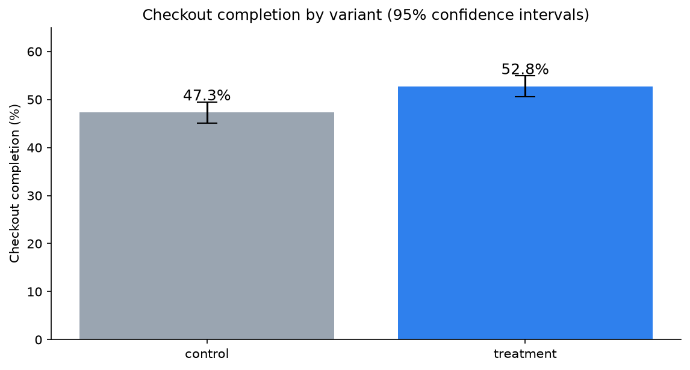
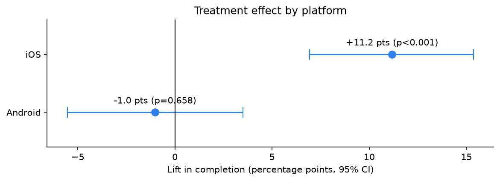
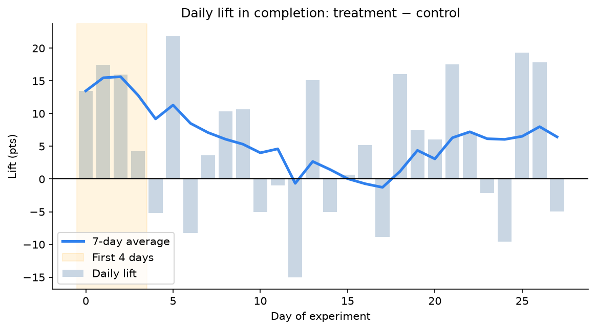

# A/B Test: Mobile Checkout Redesign

An end-to-end experiment analysis in Python: **power analysis → data quality and SRM checks → significance testing → bootstrap → segments with multiple-testing correction → novelty check → ship decision**.

**Decision: ship the redesign to iOS.** Checkout completion rose **+5.4 pts overall (47.3% → 52.8%, p < 0.001)**, driven entirely by iOS (**+11.2 pts**, where Apple Pay was added). Android showed no effect. Sized on the post-novelty lift, the iOS rollout is worth about **AED 2.3M a year**.

> Follows on from the [e-commerce analysis](https://github.com/dilrushabdulmajeed-lang/ecommerce-analytics), which found mobile checkout completion at 46% against 78% on desktop. The data is synthetic (generated in ClickHouse); the methods are what a real experiment would need.

📓 **[Read the notebook](notebooks/checkout_ab_test.ipynb)** (it renders on GitHub with all outputs and charts)



## Results

| Step | Method | Result |
|---|---|---|
| Sample size | Power analysis (α = 0.05, power = 0.8, MDE = 5 pts) | 1,568 users/group needed; ~2,000 collected ✅ |
| Data quality | Duplicate and consistency checks | 41 double-logged assignments removed |
| Randomization | Sample ratio mismatch (chi-square) | 50.4 / 49.6 split, p = 0.59: clean ✅ |
| **Primary: completion** | Two-proportion z-test + 95% CI | **+5.4 pts (CI +2.4 to +8.5), p = 0.0006** |
| Secondary: revenue/user | Welch t-test + 10k-sample bootstrap (skewed data) | +AED 81 (+8.8%), bootstrap CI +6 to +155 |
| Guardrail: order value | Mann-Whitney U | No change (p = 0.80): not smaller baskets ✅ |
| Segments | Per-platform z-tests, Holm-corrected, plus a logistic-regression interaction test | iOS **+11.2 pts** (p < 0.001); Android −1.0 (p = 0.66); interaction p = 0.0001 |
| Novelty | Daily lift, early vs steady state | First 4 days +13 pts → **+4.2 pts from day 5**: forecast on the steady state |




## Why these methods
- **Power analysis first:** without it, a "no significant difference" result is uninterpretable, because the test might have been too small to see anything.
- **SRM check:** a broken 50/50 split (bots, redirects, logging bugs) silently biases results. It's checked before reading any metric.
- **Bootstrap for revenue:** half the users have AED 0 and order values are right-skewed. The bootstrap needs no normality assumption, and its result is cross-checked with Welch's t-test.
- **Holm correction and an interaction test:** testing several segments inflates false positives. "Significant on iOS, not on Android" doesn't by itself prove the effects differ; the interaction term tests that directly.
- **Steady-state sizing:** the early novelty boost would overstate the long-run impact by about 3×.

## Decision memo
See [docs/decision-memo.md](docs/decision-memo.md).

## Repo structure
```
├── notebooks/checkout_ab_test.ipynb   # the full analysis (executed, with outputs)
├── data/experiment.csv                # snapshot: 4,041 rows incl. 41 duplicates
├── sql/01_experiment_data.sql         # ClickHouse table + synthetic data generation
├── docs/
│   ├── decision-memo.md
│   └── figures/                       # charts exported by the notebook
└── requirements.txt
```

## Run it
```bash
python3 -m venv .venv && .venv/bin/pip install -r requirements.txt
.venv/bin/jupyter lab notebooks/checkout_ab_test.ipynb
```
The notebook reads `data/experiment.csv` by default. With `CH_USER` and `CH_PASSWORD` set, it reads the live table from ClickHouse instead (the [marketing-analytics-pipeline](https://github.com/dilrushabdulmajeed-lang/marketing-analytics-pipeline) stack).
